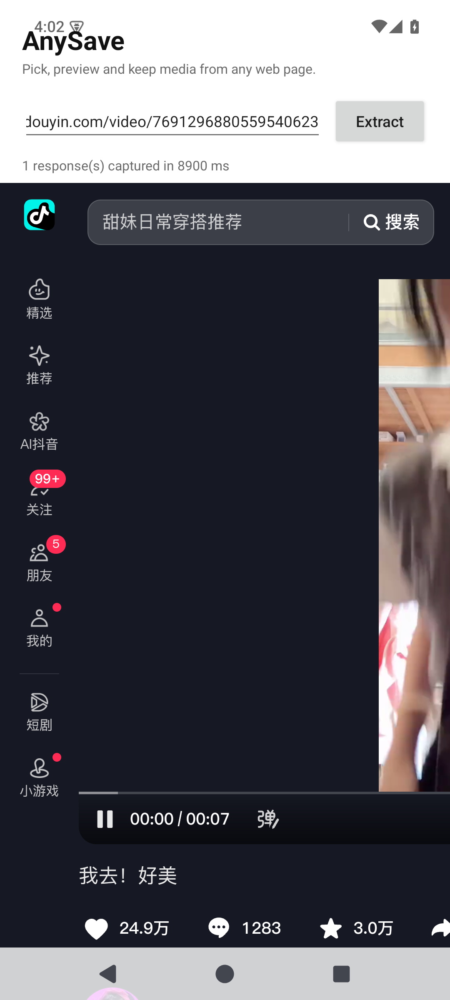

# AnySave

> Pick, preview and keep media from any web page.

从任意网页里，先看、再选、再存。

AnySave 是一个 Android 原生应用：**无服务端、无 Termux、无 Cookie 导出**。
它用真实的 WebView 打开页面，让页面自己的 JavaScript 完成签名和请求，应用只负责
捕获响应、预览、勾选、保存，并按需上传到 Telegram。

## 状态

**M0 骨架**（可编译、可运行）。目前打通的链路：

- 输入链接 → WebView 打开页面
- 文档开始时注入响应监听（`app/src/main/res/raw/hook.js`）
- 捕获页面自身发出的 `/aweme/v1/web/aweme/detail/` 响应（抖音）
- 捕获结果输出到界面与 logcat

验证数据见 [docs/verification.md](docs/verification.md)：在桌面 Chrome 155 和
Android 15 / 系统 WebView 124 上，均确认「页面自己签名、应用只收响应」成立；
M0 应用内也完成了一次端到端捕获（8.9 秒拿到 detail 响应）。



## 为什么不是传统下载器

传统做法是「用 HTTP 客户端重放请求」，于是不得不持续逆向站点签名
（a_bogus、WBI、xsec_token……），还要让用户导出 Cookie。AnySave 反过来：

1. **会话不出浏览器** —— 在 WebView 里登录一次，没有 Cookie 文件，没有导入导出
2. **让页面自己签名** —— 请求由站点自己的 JS 发出，签名天然有效
3. **只观察，不重放** —— 应用只捕获页面已经拿到的响应
4. **先看、再选、再存** —— 预览和过滤是产品核心，不是附加功能

## 目录结构

```
app/src/main/
├── java/io/github/backtraxe/anysave/
│   ├── MainActivity.kt          链接输入 + 触发提取
│   ├── extractor/PageExtractor.kt  文档开始注入、轮询、解析快照
│   ├── reader/SiteReader.kt     站点 reader 接口与注册表
│   ├── reader/DouyinReader.kt   抖音 reader（M0）
│   └── model/MediaHit.kt        捕获结果的数据模型
└── res/raw/hook.js              fetch / XHR 响应监听（在页面上下文运行）
docs/
├── architecture.md              设计说明
└── verification.md              关键假设的验证记录
```

## 构建

需要 JDK 17、Android SDK 35。

```bash
cp local.properties.example local.properties   # 改成你本机的 SDK 路径
./gradlew :app:assembleDebug
```

APK 输出：`app/build/outputs/apk/debug/app-debug.apk`。

## 路线图

- **M0** 工程骨架 + WebView 会话 + 响应捕获 ✅
- **M1** 抖音：解析 `aweme_detail` → 媒体清单 → 预览网格（缩略图、多选、过滤）
- **M2** 下载：Cookie / Referer、并发、MediaStore 写相册、进度与通知
- **M3** Telegram：Bot API 上传（相册分组、caption）
- **M4** 更多 reader：小红书 `__INITIAL_STATE__`、B 站；YouTube 走专用库兜底
- **M5** reader 热更新（脚本包 + 哈希校验）

## 已知限制

- 目前只匹配 `www.douyin.com`，短链 `v.douyin.com` 尚未展开
- 未登录时可能捕获不到数据——先在 WebView 里登录，再点提取
- M0 没有预览、下载和保存，只有「输入 → 提取 → 显示捕获结果」
- 项目尚未选择开源许可证

## 免责声明

本项目仅供个人备份自己有权保存的内容。使用前请遵守目标站点的服务条款与
当地法律，不要用于批量抓取、二次分发或任何侵犯版权与隐私的用途。
