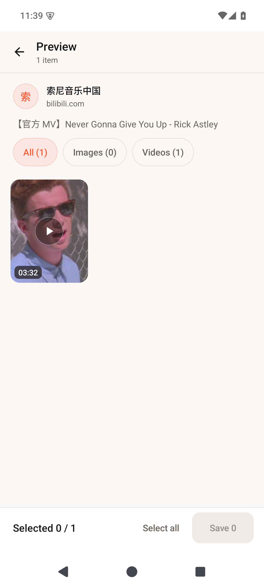
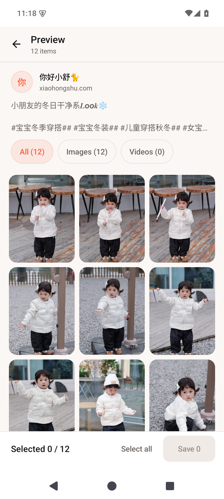
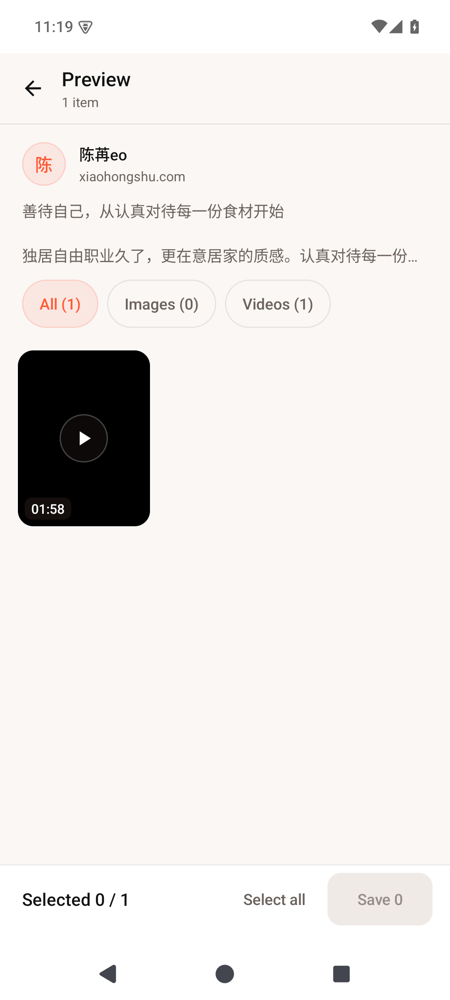
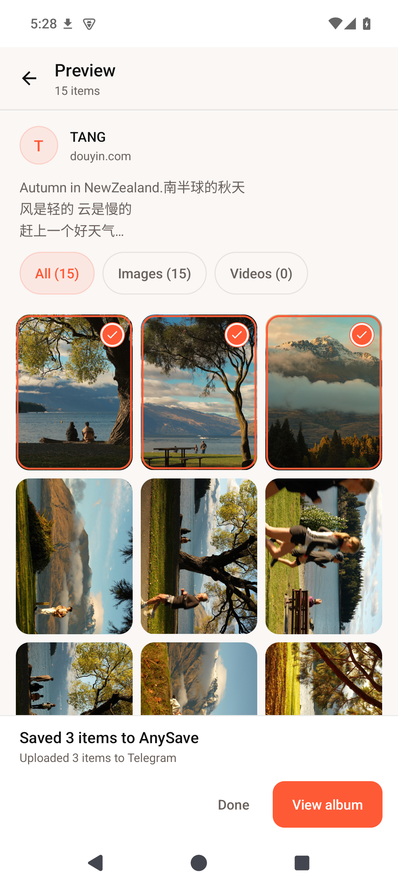
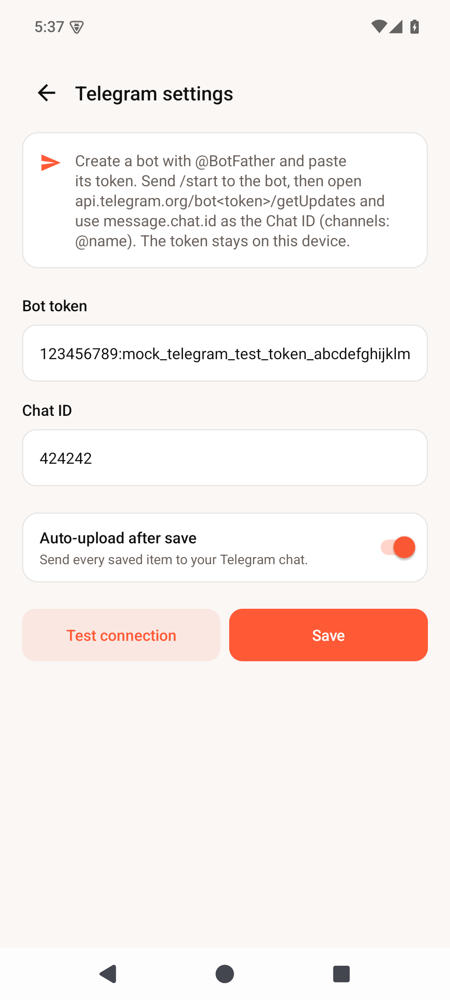
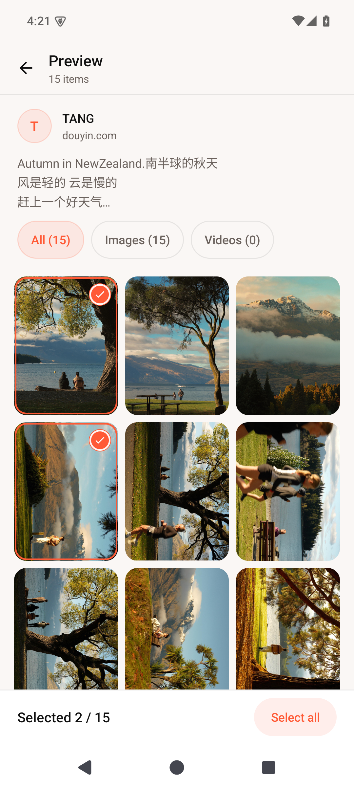

# AnySave

[](https://github.com/backtraxe/anysave/actions/workflows/ci.yml)

> Pick, preview and keep media from any web page.

从任意网页里，先看、再选、再存。

AnySave 是一个 Android 原生应用：**无服务端、无 Termux、无 Cookie 导出**。
它用真实的 WebView 打开页面，让页面自己的 JavaScript 完成签名和请求，应用只负责
捕获响应、预览、勾选、保存，并按需上传到 Telegram。

## 状态

**M11.2 真实登录态验证 + 抖音重定向修复**（可编译、可运行、已端到端验证）。完整链路：

- 输入链接 → WebView 打开页面
- 文档开始时注入响应监听（`app/src/main/res/raw/hook.js`），命中时连同响应体一起留下
- 捕获页面自身发出的 `/aweme/v1/web/aweme/detail/` 响应
- 抖音 reader 把 `aweme_detail` 解析成媒体清单：图文取 `images[]`（跳过水印版、优先
  jpeg），视频取 `play_addr`，并带作者、文案、尺寸与时长
- **小红书 reader（M4）**：笔记页同样是 SSR，从 `window.__INITIAL_STATE__` 读取笔记
  （两种数据结构都兼容）；图片优先原图（`ci.xiaohongshu.com/<fileId>`）、显示版 webp
  作为预览与兜底，视频取 `h264` 最高画质 `masterUrl`（单文件含音轨）
- **B 站 reader（M5）**：视频页内嵌 `__INITIAL_STATE__.videoData` + `__playinfo__`，
  只有 DASH 分离流；应用下载视频 m4s 与音频 m4s 后，用 Android
  `MediaExtractor`/`MediaMuxer` 在本机**合流成一个 MP4** 再写入相册（不转码、不重放 API）
- **微博 reader（M8）**：`weibo.com/<uid>/<bid>` 会重定向到移动页，SSR 里带
  `window.$render_data.status`；图片取 `pics[].large`，视频取 `page_info.urls`
  最优档；新媒体 CDN 走 `MediaSite.WEIBO` 的 Referer
- **YouTube（M8）**：唯一不走 WebView 观察的站点——页面只给 cipher/ABR 流，
  因此按路线图预留的「专用库兜底」接入 GPL-3.0 的 NewPipeExtractor，
  解析出 AVC MP4 + M4A 后交给本机合流/保存
- **登录/会话（M9）**：设置页「登录」用**站点桌面版登录页**（App 内 WebView、
  手机扫码），登录态就是 WebView 的 Cookie，只存在应用私有目录；可一键清除
  所有站点登录态。抖音提取必须登录，B 站登录后可拿更高清晰度
- **登录态检测（M11）**：设置页打开时用一个隐藏 WebView 依次探测三站登录状态，
  显示 `抖音：已登录 · 昵称 / B站：未登录 / 小红书：未登录`；清除登录态后自动刷新。
  探测只读页面状态，不读取、不打印 Cookie 值
- **AcFun 图文（M10）**：A 站文章页 `/a/ac<id>` 是 SSR，`window.articleInfo`
  内含标题/作者/封面与 `parts[].content` HTML；从 HTML 里取原图（aixifan CDN）保存。
  A 站视频是 HLS，当前下载管线不支持，暂不做（非当前重点）
- **reader 热更新（M7）**：设置里填一个 reader pack URL，即可远程更新内置 reader 的
  页面提取脚本与响应匹配规则（带 sha256 校验、大小/白名单限制），站点改版不必发新版 APK；
  编译进 APK 的解析器与下载逻辑不变
- 图文笔记页是服务端渲染（SSR），不发 detail 请求：改为读取页面已经内嵌的
  RSC 数据（`window.__pace_f`），**不构造任何请求、不算任何签名**
- 预览面板：3 列缩略图网格、全部 / 图片 / 视频筛选、多选、长按全屏查看、返回网页
- 保存：勾选后点「保存」→ 前台服务并发下载（最多 3 个）→ 写入系统相册
  `Pictures/AnySave` / `Movies/AnySave`，带进度条与系统通知
- **Telegram（可选）**：设置里填 Bot Token 与 Chat ID（保存在本机私有配置，可发测试
  消息验证）；保存完成后自动把同一批媒体按相册分组上传，caption 带原文案、作者与
  来源链接；通知与面板同步显示上传进度和结果

模拟器端到端实测（Android 15 / 系统 WebView 124）：

| 场景 | 结果 |
|---|---|
| 视频笔记 | 7.7 s 解析出 1 个视频，封面与时长 00:07 正常显示 |
| 图文笔记（15 图） | 9.4 s 解析出 15 张图片，内嵌数据 50,877 字符，15/15 缩略图加载成功 |
| 保存 3 张图片 | 3 个文件写入 `Pictures/AnySave`，尺寸与解析结果一致，MediaStore 无残留 pending 行 |
| 保存 1 个视频 | 1,560,178 B 写入 `Movies/AnySave`，`ftyp isom`，分辨率 1080×1920 |
| 上传 3 张图片 | 1 次 `sendMediaGroup`（attach://file0..2），caption 只在首图，字节 SHA-256 与相册文件一致 |
| 上传 1 个视频 | 1 次 `sendVideo`，caption 含文案 + 作者 + 来源 |
| 失败路径 | Bot API 返回 400 时上传计失败、相册文件保留、应用不崩溃、UI/通知显示失败数 |
| 设置页 | 预填、保存、`getMe` + `sendMessage` 测试连接均通过 |
| 小红书图文（12 图） | 4 s 内解析出 12 项，缩略图加载成功；保存 3 张**原图**（1,775,889 / 1,763,912 / 2,073,854 B，2730×4096），MediaStore 无 pending 残留 |
| 小红书视频（1 条） | 保存 11,285,434 B 单文件 MP4：h264 720×1280 + AAC 48 kHz 立体声，时长 118.14 s，与 payload 一致 |
| B 站视频（1 条） | 2.09 s 解析出 1 项（标题/作者/封面/03:32）；保存时下载 20,872,903 B 视频 + 5,408,198 B 音频，合流为 26,309,419 B MP4（h264 852×480 + AAC 48 kHz 立体声、212.31 s），ffprobe 与 2 s 解码校验通过 |
| YouTube 视频 | 6.5 s 解析出 1 项（“Me at the zoo”，19 s）；保存时下载 AVC 视频 + M4A 音频，合流为 746,914 B MP4（h264 320×240 + AAC 44.1 kHz，19.06 s），ffprobe/解码通过 |
| 微博图文（3 图） | 3.2 s 解析出 3 项（作者杨伊琳10）；保存 3 张原图 229,606 / 256,742 / 221,566 B，MediaStore 尺寸正确、无 pending |
| 微博视频（1 条） | 2.0 s 解析出 1 项；保存 1,896,528 B MP4（h264 720×1280 + AAC 44.1 kHz 立体声，13.72 s） |
| 登录态检测 | 清空会话后三站均显示「未登录」；用真实浏览器会话后 `Douyin: Logged in · 背影` / `Bilibili: Logged in · Backtraxe` / `Xiaohongshu: Logged in · 山水之间`；清除后恢复未登录；探测不输出 Cookie 值 |
| 登录专属能力 | B 站登录后同一视频从 480P/26.3 MB 提升到 **1080P/75.2 MB**（h264 1920×1080 + AAC 212.31 s）；小红书真实笔记 6 项；抖音登录后重定向到 `m.douyin.com/share` 的问题已修复（桌面 UA + origin hook 别名） |
| AcFun 图文（3 图） | 2.0 s 解析出 3 项（作者 AcFun活动）；保存 1,658,046 B PNG + 2,256,625 B PNG + 2,642,498 B JPEG（8000×4500 封面，容器嗅探把 .png 纠正为 .jpg），MediaStore 三行 pending 0 |
| 登录/会话 | 设置页登录卡片打开桌面版页面：抖音标题「抖音-记录美好生活」、B 站「哔哩哔哩…」、小红书直接跳 `/login` 且有扫码入口；注入的会话 Cookie 重启应用后仍在（3/3），清除后 3 站 Cookie 行数归 0 |
| 登录后回归 | 带 Cookie 的抖音提取 `Parsed 1 item(s) in 8179 ms`；B 站未登录仍解析 480P（`Parsed 1 item(s) in 5764 ms`）；无 Cookie 的抖音超时提示改为「…请在设置 → 登录中扫码登录」 |
| reader 热更新 | 从本地 mock pack 应用覆盖后，未重装应用即把小红书页面解析替换为固定 payload（12 项，2.0 s）；坏 sha256 的 pack 被拒绝且旧 pack 保留；响应模式覆盖触发 hook 重注册（`hot=true`）并能在命中噪声 XHR 时回退到内嵌脚本（0.7.2） |













## 为什么不是传统下载器

传统做法是「用 HTTP 客户端重放请求」，于是不得不持续逆向站点签名
（a_bogus、WBI、xsec_token……），还要让用户导出 Cookie。AnySave 反过来：

1. **会话不出浏览器** —— 在 WebView 里登录一次，没有 Cookie 文件，没有导入导出
2. **让页面自己签名** —— 请求由站点自己的 JS 发出，签名天然有效
3. **只观察，不重放** —— 应用只捕获页面已经拿到的响应；页面没发请求的 SSR 页面，
   就读取它已经渲染进 HTML 的数据，而不是替它构造一次请求
4. **下载不重演签名** —— 保存时只用页面已经收到的媒体 CDN 地址（带时效签名），
   直接 GET 字节；实测图文/视频 CDN 均不需要 Cookie，需要时也只从 WebView 的
   `CookieManager` 进程内读取，永不落盘
5. **Telegram 凭据只在本机** —— bot token 存在应用私有 SharedPreferences，不上传、
   不写日志、不进仓库；上传只走官方 Bot API
6. **先看、再选、再存、再传** —— 预览和过滤是产品核心，不是附加功能
7. **唯一例外**：YouTube 的播放地址必须由播放器协议解密，按路线图预留的「专用库兜底」
   接入 NewPipeExtractor（GPL-3.0）；其余站点仍然只观察页面已经产生的数据

## 目录结构

```
app/src/main/
├── java/io/github/backtraxe/anysave/
│   ├── MainActivity.kt              链接输入 + 提取 + 面板/保存接线 + 权限
│   ├── TelegramSettingsActivity.kt  Telegram 设置（token / chat id / 自动上传 / 测试）
│   ├── extractor/PageExtractor.kt   注入、轮询、取响应体、解析、SSR 兜底
│   ├── reader/SiteReader.kt         站点 reader 接口与注册表
│   ├── reader/DouyinReader.kt       抖音 reader（响应模式 + 内嵌数据脚本）
│   ├── reader/DouyinParser.kt       aweme_detail → MediaItem（纯 JVM，可单测）
│   ├── reader/XiaohongshuReader.kt  小红书 reader（SSR 内嵌数据，无网络响应模式）
│   ├── reader/XiaohongshuParser.kt  小红书 note → MediaItem（纯 JVM，可单测）
│   ├── reader/BilibiliReader.kt     B 站 reader（SSR + 桌面 UA）
│   ├── reader/BilibiliParser.kt     videoData + playinfo → DASH MediaItem（可单测）
│   ├── reader/ReaderPack.kt         热更新包格式 / sha256 校验（纯 JVM，可单测）
│   ├── reader/ReaderOverrides.kt    进程内覆盖 + 持久化
│   ├── reader/ReaderPackRepository.kt 拉取 / 校验 / 应用远程 pack
│   ├── reader/DirectExtractor.kt     专用提取器接口（YouTube 等）
│   ├── reader/YouTubeExtractor.kt    NewPipeExtractor 封装 + 选流（纯 JVM 可测）
│   ├── reader/WeiboReader.kt         微博 reader（SSR，$render_data.status）
│   ├── reader/WeiboParser.kt         微博 status → MediaItem（纯 JVM，可单测）
│   ├── reader/AcfunReader.kt         A 站文章 reader（SSR articleInfo）
│   ├── reader/AcfunParser.kt         文章 parts HTML → 原图（纯 JVM，可单测）
│   ├── session/LoginSignals.kt       三站登录信号解析（纯 JVM，可单测）
│   ├── session/SessionManager.kt     登录站点入口 + 清除全部会话
│   ├── model/MediaItem.kt           MediaItem / PostMedia
│   ├── model/MediaHit.kt            MediaHit / ExtractionSnapshot
│   ├── model/MediaSite.kt           站点枚举：文件名前缀 + CDN Referer
│   ├── model/SaveState.kt           保存 + 上传流程的 UI 状态
│   ├── download/MediaNaming.kt      相册路径 / 文件名 / MIME（纯 JVM，可单测）
│   ├── download/SaveJobCodec.kt     Activity ↔ Service 的任务编解码
│   ├── download/MediaSaver.kt       CDN 下载 + MediaStore 写入（含兜底 URL / 容器嗅探）
│   ├── download/MediaSniffer.kt     从首字节识别 jpg/png/webp/gif/mp4/mov
│   ├── download/DashMuxer.kt        DASH 视频+音频 → 单 MP4（不转码）
│   ├── download/SaveStateBus.kt     进程内保存/上传状态分发（主线程）
│   ├── download/SaveService.kt      dataSync 前台服务、3 并发、保存后上传、通知
│   ├── telegram/TelegramSettings.kt 本地配置（debug 可覆盖 API base 做 mock 测试）
│   ├── telegram/TelegramProtocol.kt 纯协议规则：caption / 分组 / 限额（可单测）
│   ├── telegram/MultipartBody.kt    multipart/form-data 编码（可单测）
│   ├── telegram/TelegramClient.kt   Bot API：getMe / sendMessage / 相册上传
│   └── ui/                          预览面板、网格、缩略图加载、全屏查看
└── res/raw/hook.js                  fetch / XHR 响应监听（页面上下文运行）
app/src/test/                        解析 / 命名 / 容器识别 / Telegram / pack / YouTube 选流 / 登录信号（71 条）
docs/
├── architecture.md                  设计说明
└── verification.md                  关键假设的验证记录
```

## 构建与测试

需要 JDK 17、Android SDK 35。

```bash
cp local.properties.example local.properties   # 改成你本机的 SDK 路径
./gradlew :app:assembleDebug
./gradlew :app:testDebugUnitTest               # 71 条单测，含真实响应 fixture
```

APK 输出：`app/build/outputs/apk/debug/app-debug.apk`。

打包一个按「应用名 + 版本号」命名的发布 APK：

```bash
./gradlew :app:namedReleaseApk
# -> dist/AnySave-0.4.0.apk（有本机签名配置时已签名，否则带 -unsigned 后缀）
```

## CI/CD 与发布

- **CI**（[`.github/workflows/ci.yml`](.github/workflows/ci.yml)）：push 到 `main` / PR 时
  跑单元测试、构建 debug 与 release APK，并上传按版本命名的 debug APK artifact。
- **Release**（[`.github/workflows/release.yml`](.github/workflows/release.yml)）：
  推送 `v*` 标签（或手动 dispatch）时构建 release APK；配置签名 secrets 后产出已签名
  `AnySave-<version>.apk` 并自动创建 GitHub Release，未配置则产出 `-unsigned` 包。
- **签名**：本地用 gitignore 的 `keystore.properties` + keystore；CI 用
  `RELEASE_KEYSTORE_BASE64` / `RELEASE_STORE_PASSWORD` / `RELEASE_KEY_ALIAS` /
  `RELEASE_KEY_PASSWORD` 四个 secrets。详细步骤见
  [docs/releasing.md](docs/releasing.md)。
- release 包不包含调试入口（demo Activity 只在 debug 源集），且 WebView 调试仅在
  debug 构建开启。

## Telegram 配置

1. 在 Telegram 找 **@BotFather**，`/newbot` 拿到 bot token
2. 给 bot 发一条消息（如 `/start`），浏览器打开
   `https://api.telegram.org/bot<token>/getUpdates`，取 `message.chat.id`
   （频道可填 `@频道名`）
3. 应用右上角齿轮 → Telegram 设置：填 token 与 chat id → 「测试连接」→ 保存
4. 勾选「保存后自动上传」，之后每次保存都会把同一批媒体按 Telegram 相册（≤10 个/组）
   发到该会话

## 登录 / 会话

首次使用需要登录的站点（目前是抖音；B 站登录可解锁更高清晰度）：

1. 点右上角齿轮 → 滚到底部「登录」卡片；
2. 点 **抖音 / B站 / 小红书**，App 会用桌面版页面打开该站点（不是「下载 APP」页）；
3. 在页面里点「登录」，用手机 App 扫码；登录成功后返回；
4. 粘贴作品链接，点 Extract 即可（会话 Cookie 在应用内共享，重启后仍有效）；
5. 需要退出时点「清除所有登录态」（会同时清掉各站访客 Cookie 与 WebStorage）。

登录态完全保存在本机 WebView：不导出 Cookie、不写自定义 Cookie 文件、不打印到日志。
YouTube 走专用提取器，不需要登录；微博公开内容也不需要登录。

## Reader 热更新

站点改版时，不一定要发新版 APK：设置页底部的「Reader updates」卡片可以拉取一个
reader pack JSON，替换内置 reader 的**页面提取脚本**与**响应匹配规则**（编译进 APK 的
解析/下载逻辑不变）。

```json
{
  "version": 1,
  "readers": [
    {
      "id": "douyin",
      "embeddedPayloadScript": "(function(){ ... })()",
      "sha256": "<脚本字符串的 sha256>",
      "responsePatterns": ["/aweme/v1/web/aweme/detail/"]
    }
  ]
}
```

- 支持的 reader id：`douyin` / `xiaohongshu` / `bilibili`
- 每个脚本必须带 sha256 且一致，否则整包拒绝、旧 pack 保持生效
- release 只允许 https URL；debug 允许 http 便于本地联调
- 清空 URL 再点「检查并更新」= 移除已应用的 pack

## 路线图

- **M0** 工程骨架 + WebView 会话 + 响应捕获 ✅
- **M1** 抖音：解析 `aweme_detail` → 媒体清单 → 预览网格（缩略图、多选、筛选）✅
- **M2** 下载：CDN 直取、3 并发、MediaStore 写相册、进度与通知 ✅
- **M3** Telegram：Bot API 上传（相册分组、caption、可开关的自动上传）✅
- **M4** 更多 reader：小红书 `__INITIAL_STATE__` ✅（分享链接，预览 + 保存）
- **M5** B 站：DASH 音视频合流后保存 ✅
- **M6** YouTube 兜底（NewPipeExtractor，GPL-3.0）✅
- **M7** reader 热更新（脚本包 + 哈希校验）✅
- **M8** 微博 reader（SSR）+ 项目采用 GPL-3.0 ✅
- **M9** 登录/会话管理（站内桌面登录页 + 清除登录态）✅
- **M10** AcFun 图文 reader（SSR articleInfo）✅
- **M11** 登录态检测（抖音/B站/小红书，设置页自动探测）✅

## 已知限制

- 目前支持抖音、小红书与 B 站；抖音短链 `v.douyin.com`、小红书短链 `xhslink.com`、
  B 站短链 `b23.tv` 尚未展开
- 小红书必须粘贴**带 `xsec_token` 的分享链接**（`/discovery/item/<id>?xsec_token=…`）；
  裸 `/explore/<id>` 会被小红书重定向到验证页。token 会过期，重新分享即可
- 小红书未登录时 `/explore` 首页不可浏览（登录墙），本应用只处理单篇笔记链接
- 小红书实况图（live photo）只取静态图；原图拉取失败时自动回退显示版 webp（文件名/MIME 会按实际字节修正）
- B 站清晰度取决于登录态：未登录只能拿到 480P/360P（1080P 需要有效 Cookie/大会员）；
  B 站保存需要本机合流（约多花几秒），合流失败会按失败计数、不留半截文件
- YouTube 走专用提取器：需要 NewPipeExtractor 与新协议同步升级；为避免超大文件，
  视频流上限 720p；无登录时清晰度取决于 YouTube 下发的可用档位
- 微博：公开单条链接可直接解析（自动 visitor cookie）；`/u/` 主页、话题页等暂不支持；
  视频 CDN 直链约 2 小时过期，需解析后尽快保存
- A 站只支持文章（图文）页；视频页是 HLS 流，下载管线暂不支持
- 登录态检测依赖站点页面信号：抖音用 `user/self` 标题里的昵称、B 站用
  `x/web-interface/nav`、小红书用 `__INITIAL_STATE__.user.loggedIn`；站点改版可能导致
  检测失败（显示「检测失败」），不影响实际提取
- 清除登录态会清除所有站点（包括访客 Cookie）
- YouTube 不支持登录（专用提取器，最高 720p）；本机 googlevideo 网络异常不在应用控制范围
- reader 热更新只能替换页面 JS 与响应规则，不能远程改解析器/下载逻辑；release 只允许
  https pack URL，pack 的信任边界就是它的 URL（无签名，但每个脚本必须带 sha256）
- 未登录时可能捕获不到数据——先在 WebView 里登录，再点提取
- 图文笔记依赖页面内嵌数据：站点改版时需要更新 reader 的内嵌数据脚本
- 实况图（live photo）的动态部分暂不预览、不保存，只取静态图
- 保存不支持取消 / 断点续传；同名文件重复保存时由 MediaStore 自动加 `(1)` 后缀
- API 26–28 走 `DATA` 路径 + 存储权限的兼容分支，未在真机上验证（模拟器为 API 35）
- Telegram 上传是「保存后自动上传」：不做手动补传、不做失败重试与 429 退避；
  单文件超过 Bot API 限制（图片 10 MB / 视频 50 MB）会被跳过并计入失败；
  相册按 10 个/组切分，caption 只挂在每组首项上
- 没有通知权限时保存仍然可用，只是看不到进度通知
- 真实 Bot API 联调需要你自己的 token（本仓库测试用本地 mock 验证协议）；
  在设置页点「测试连接」即可确认真实凭据
- 视频本身暂不能在应用内播放
- 项目采用 GPL-3.0（见 [LICENSE](LICENSE)），因为 YouTube 支持依赖 GPL-3.0 的
  NewPipeExtractor；若要改为其它许可证，需要替换/移除该依赖

## 许可证与第三方组件

- 本项目以 **GPL-3.0** 发布，完整文本见 [LICENSE](LICENSE)。
- YouTube 提取使用 [NewPipeExtractor](https://github.com/TeamNewPipe/NewPipeExtractor)
  （GPL-3.0，© TeamNewPipe），它是本项目唯一的专用提取器；页面观察路线（抖音/小红书/
  B 站）不依赖它。
- 其余依赖：AndroidX、Kotlin、jsoup、nanojson、protobuf-javalite、Rhino 等，
  各自遵循其开源许可证。

## 免责声明

本项目仅供个人备份自己有权保存的内容。使用前请遵守目标站点的服务条款与
当地法律，不要用于批量抓取、二次分发或任何侵犯版权与隐私的用途。
